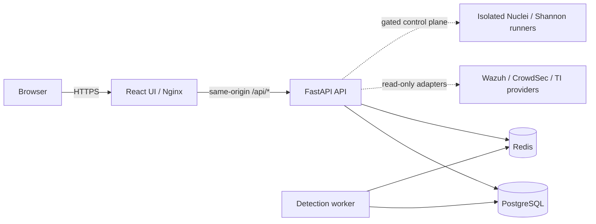

# OpsAegis
  
<p align="center">
  <strong>Operational Security & Incident Governance</strong><br />
  A security-operations workspace for collecting evidence, correlating findings, investigating incidents and governing response workflows.
</p>

<p align="center">
  <a href="https://frontend-production-cdff.up.railway.app/">Live dashboard</a> ·
  <a href="https://github.com/Atharva-ark06/OpsAegis/issues">Issues</a> ·
  <a href="https://github.com/Atharva-ark06/OpsAegis/pulls">Pull requests</a>
</p>

## Contents

- [What it does](#what-it-does)
- [Production dashboard](#production-dashboard)
- [Capabilities](#capabilities)
- [Architecture](#architecture)
- [Local development](#quick-start--local-development)
- [Production deployment](#production-deployment)
- [Configuration and secrets](#configuration-and-secrets)
- [Development and verification](#development-and-verification)
- [Security and authorization](#security-and-authorization)
- [Documentation map](#documentation-map)
- [Project status](#project-status)

--- 

## What it does

OpsAegis brings security telemetry and investigation workflows into one authenticated workspace. It is designed to preserve source provenance, keep integrations read-only by default, and separate an approval record from the execution of a response action.

**Core stack**

- **Frontend:** React, TypeScript, Vite and a responsive operational dashboard.
- **API:** FastAPI, Python, PostgreSQL, Alembic migrations and JWT/RBAC.
- **Queue and coordination:** Redis, with separately run workers for scheduled processing.
- **Deployment:** Docker images and Railway-managed services; a separate production Docker Compose topology is also maintained.

## Production dashboard

<https://frontend-production-cdff.up.railway.app/>

The Railway deployment currently uses separate frontend, API and detection-worker services, with managed PostgreSQL and Redis. The browser accesses the API through the frontend's same-origin `/api/` reverse proxy; internal services are not intended to be exposed as public browser endpoints.

A live URL only confirms that the dashboard is reachable. It does not, by itself, prove that every external engine is configured, ingesting current telemetry or passing its operational acceptance checks. See [release readiness](docs/RELEASE_READINESS.md) for the distinction between implementation, CI, staging evidence and production validation.

## Capabilities

| Area | What is implemented |
|---|---|
| Identity and access | First-admin bootstrap, authenticated sessions, role-based access and audit events |
| Security telemetry | Read-only Wazuh Indexer alert ingestion and Wazuh Manager agent inventory |
| Threat decisions | CrowdSec active-decision collection; optional bounded alert-history reads |
| Vulnerability management | Wazuh vulnerability inventory, Nuclei finding records and NVD CVE enrichment |
| Threat intelligence | On-demand VirusTotal and AbuseIPDB lookups with backend-only credentials |
| Detection operations | Persisted findings, scheduled evaluation, worker coordination and in-app notifications |
| Incident response | Assignment, lifecycle transitions, investigation timeline, notes and evidence attachments |
| Governance | Playbook catalogue, dry-run previews, approval records and an execution ledger |
| Reporting | Bounded operational metrics with JSON/CSV exports |

### Integration boundaries

- Wazuh, CrowdSec, VirusTotal, AbuseIPDB and NVD integrations use bounded read/lookup operations.
- Nuclei requires an explicitly registered and authorized target plus a separate isolated scanner worker.
- Shannon requires a separately deployed, isolated runner and is intended for disposable authorized staging environments.
- Playbook approval currently records governance decisions; it does **not** execute provider response actions.
- A configured adapter, green health indicator or passing CI job is not proof of live telemetry ingestion.

See the [integration matrix](docs/INTEGRATION_MATRIX.md) and the detailed [project status](docs/PROJECT_STATUS.md).

## Architecture



The frontend never connects directly to PostgreSQL or Redis. Worker services use their own runtime configuration and do not need unrelated provider secrets.

Read [system architecture](docs/ARCHITECTURE.md) for service responsibilities and [data flow](docs/DATA_FLOW.md) for ingestion and incident lifecycle details.

## Quick start — local development

### Prerequisites

- Python 3.11+ (use the version pinned by the repository CI if it is newer)
- Node.js 22+
- Docker Engine with the Compose v2 plugin
- Git

### 1. Clone and configure

```powershell
git clone https://github.com/Atharva-ark06/OpsAegis.git
cd OpsAegis
Copy-Item .env.example .env
```

The checked-in `.env.example` is for **local development only** and intentionally contains unsafe local defaults. Never use it as a production configuration. Keep real credentials in an untracked environment file or secret manager.

### 2. Start local dependencies

```powershell
docker compose up -d postgres redis
```

### 3. Start the API

```powershell
cd backend
python -m venv .venv
.\.venv\Scripts\Activate.ps1
pip install -r requirements.txt
alembic upgrade head
uvicorn app.main:app --reload
```

### 4. Start the frontend

In a second terminal:

```powershell
cd frontend
npm ci
npm run dev
```

The Vite development server uses the repository's configured API proxy. If your local ports or environment differ, follow [local development setup](docs/LOCAL_DEVELOPMENT.md).

## Production deployment

### Railway

The live project is deployed as separate Railway services:

| Service | Repository root | Runtime |
|---|---|---|
| Frontend | `/frontend` | `frontend/Dockerfile.production` |
| API | `/backend` | `backend/Dockerfile.production` |
| Detection worker | `/backend` | `backend/Dockerfile.production`, `python -m app.worker` |
| PostgreSQL | Managed service | Persistent database |
| Redis | Managed service | Queue/cache/coordination |

The frontend's Nginx configuration proxies `/api/` to the private API hostname. The API and worker connect to PostgreSQL and Redis through private service URLs. See [Railway deployment notes](docs/RAILWAY_DEPLOYMENT.md).

### Docker Compose

For a self-managed host, use the separate [production Compose guide](docs/PRODUCTION_DEPLOYMENT.md). It covers secrets, TLS termination, private data services, persistent volumes, migrations, health checks and operational limitations. The root `docker-compose.yml` is the local development stack, not the production recipe.

## Configuration and secrets

- Keep API keys, passwords, signing keys, certificates and bootstrap tokens on the server side.
- Never put provider secrets in `VITE_*` variables or frontend source.
- Use HTTPS and certificate verification for remote integrations.
- Give each integration a dedicated least-privilege account.
- Do not commit `.env`, `.env.production`, private keys, evidence files or backups.
- Rotate credentials that were exposed; deleting a value from Git history does not revoke it.

See [configuration reference](docs/CONFIGURATION_REFERENCE.md), [security model](docs/SECURITY_MODEL.md) and [API perimeter controls](docs/API_PERIMETER_SECURITY.md).

## Development and verification

Run checks from the relevant project directory:

```powershell
# Backend
cd backend
pip install -r requirements.txt
pytest -q

# Frontend (new terminal)
cd frontend
npm ci
npm test
npm run build
```

For production Compose validation, migration preflight, integration diagnostics and CI coverage, see [testing and CI](docs/TESTING_AND_CI.md) and [integration validation](docs/INTEGRATION_VALIDATION.md).

## Security and authorization

OpsAegis is intended for systems and targets you own or are explicitly authorized to assess.

- Keep vulnerability scanning disabled until target authorization, isolated execution and external egress controls are verified.
- Do not run Shannon against production systems; use disposable lab/staging targets.
- Do not interpret missing telemetry or failed provider requests as clean security results.
- Treat incident evidence and backups as sensitive data.
- Review and approve any future response-action adapter independently; the current playbook approval workflow does not execute actions.

To report a security issue, contact the repository maintainer through a private disclosure channel. Do not publish exploit details, credentials or sensitive infrastructure information in a public issue.

## Documentation map

| Guide | Purpose |
|---|---|
| [Architecture](docs/ARCHITECTURE.md) | Services, responsibilities and trust boundaries |
| [Data flow](docs/DATA_FLOW.md) | Collection, normalization, detections and incidents |
| [Local development](docs/LOCAL_DEVELOPMENT.md) | Workstation setup and development commands |
| [Railway deployment](docs/RAILWAY_DEPLOYMENT.md) | Current hosted service topology and deployment checks |
| [Production Docker deployment](docs/PRODUCTION_DEPLOYMENT.md) | Self-managed production Compose setup |
| [Configuration reference](docs/CONFIGURATION_REFERENCE.md) | Environment-variable handling and secret scope |
| [Integration matrix](docs/INTEGRATION_MATRIX.md) | Provider capabilities, prerequisites and limitations |
| [Security model](docs/SECURITY_MODEL.md) | Authentication, authorization and safe-operation principles |
| [Frontend guide](docs/FRONTEND_GUIDE.md) | Dashboard structure and UI conventions |
| [Frontend deployment](docs/FRONTEND_DEPLOYMENT.md) | Production assets and same-origin API proxy |
| [Role permissions](docs/ROLE_PERMISSIONS.md) | Operator roles and protected workflows |
| [Database migrations](docs/DB_MIGRATIONS.md) | Alembic workflow and schema-change checks |
| [Worker operations](docs/WORKER_OPERATIONS.md) | Queues, leases, heartbeats and recovery |
| [Threat intelligence](docs/THREAT_INTELLIGENCE.md) | IOC enrichment scope and limitations |
| [Vulnerability management](docs/VULNERABILITY_MANAGEMENT.md) | CVE provenance, asset mapping and remediation scope |
| [Incident workflow](docs/INCIDENT_WORKFLOW.md) | Triage, investigation, evidence and lifecycle |
| [Operations runbook](docs/OPERATIONS_RUNBOOK.md) | Routine health checks and recovery |
| [Testing and CI](docs/TESTING_AND_CI.md) | Local checks and automated validation |
| [Troubleshooting](docs/TROUBLESHOOTING.md) | Common setup and integration failures |
| [Contributing](CONTRIBUTING.md) | Branch, change and pull-request workflow |
| [Project status](docs/PROJECT_STATUS.md) | Current implementation checkpoint |
| [Release readiness](docs/RELEASE_READINESS.md) | Evidence required before operational acceptance |

## Project status

OpsAegis is under active development. Some capabilities are implemented in code but still require authorized staging evidence, external infrastructure or operator configuration. The project deliberately distinguishes a working UI, a configured adapter, a passing automated test and a validated production integration.

**Do not infer production readiness from the live dashboard alone.** Review [the release-readiness matrix](docs/RELEASE_READINESS.md) before enabling optional scanners or treating integrations as operational.
